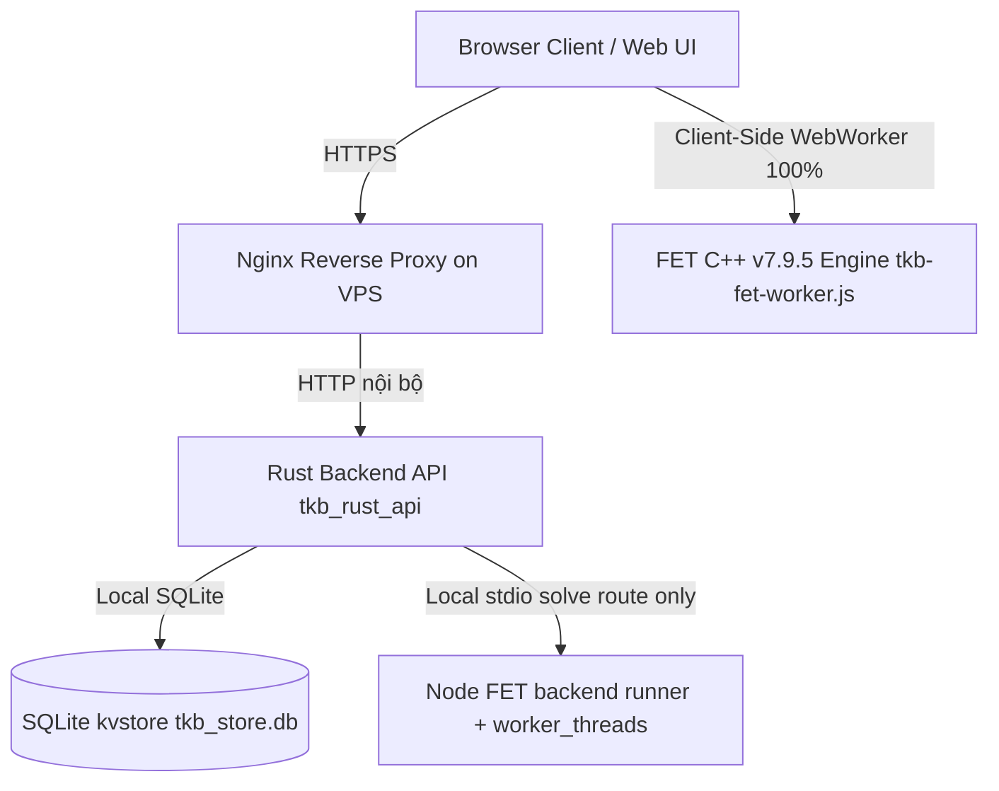

# HƯỚNG DẪN KẾ THỪA VÀ VẬN HÀNH DỰ ÁN TKB CHERRY (TKB TIMETABLE SYSTEM)
*Tài liệu bàn giao kỹ thuật toàn diện dành cho lập trình viên kế thừa dự án.*

> **Đọc kèm:** trạng thái hiện hành ngắn gọn nằm ở [`docs/CURRENT_STATE.md`](docs/CURRENT_STATE.md);
> nhật ký chi tiết từng phiên làm việc ở [`docs/PROJECT_HANDOFF.md`](docs/PROJECT_HANDOFF.md)
> (các mục cũ được chuyển vào `docs/archive/`).

---

## 1. TỔNG QUAN HỆ THỐNG VÀ KIẾN TRÚC (SYSTEM ARCHITECTURE)

Hệ thống **TKB Cherry** (`tkbcherry.com`) là nền tảng quản lý và xếp thời khóa biểu tự động thông minh dành cho trường học phổ thông, hỗ trợ quy mô trường lớn (hơn 75 lớp, hàng ngàn tiết học, hàng trăm giáo viên) với tốc độ giải siêu tốc dưới 200 ms trực tiếp trên trình duyệt.



### Các thành phần chính:
1. **Web Client (Frontend)**:
   * **Công nghệ**: HTML5, Vanilla JavaScript (ES6+), Vanilla CSS3. Không dùng framework hay build system; giao tiếp backend qua HTTP polling (không WebSocket).
   * **Giao diện phân môn & sắp xếp TKB**: `web/pages/phanmon.js`, `web/pages/sapxep.html`, `web/pages/phanmon.css`.
   * **Bộ giải & tối ưu FET Client-Side Web Worker**: `web/pages/tkb-fet-engine.js`, `web/pages/tkb-fet-worker.js`. Đường mặc định vẫn chạy cục bộ trên trình duyệt. Riêng incumbent đã xếp đủ trên hostname local có thể chọn backend FET bổ trợ qua Rust local API; đường này bị khóa trên hostname production và không gửi dữ liệu lịch ra ngoài.
   * **Quản trị hệ thống & Cổng trường học**: `web/super-admin.js`, `web/school-portal.js`, `web/app.js`.

2. **Backend API Server (Rust)**:
   * **Thư mục**: `rust_api/`
   * **Công nghệ**: Rust **thuần thư viện chuẩn** — HTTP server tự viết trên `std::net::TcpListener` + thread pool, **không dùng** Axum/Tokio hay framework async nào. Dependency chỉ gồm `argon2`, `serde_json`, `rusqlite`, `sha2` (xem `rust_api/Cargo.toml`).
   * **Xác thực**: mật khẩu băm **Argon2id**; phiên đăng nhập dùng **session token ngẫu nhiên (opaque Bearer token)** lưu trong SQLite — **không phải JWT**. Xem `rust_api/src/auth.rs`.
   * **Chức năng**: quản lý phiên đăng nhập, phân quyền đa cấp, lưu trữ và đồng bộ dữ liệu trường học.
   * **Cổng lắng nghe**: cấu hình qua `TKB_RUST_HOST` / `TKB_RUST_PORT` trong `.env`; mặc định local là `127.0.0.1:1010`. Trên VPS, port nội bộ do file service systemd quyết định — kiểm tra cấu hình Nginx/systemd trên máy chủ thay vì giả định.

3. **Hạ tầng VPS**:
   * **VPS**: Ubuntu 24.04 LTS, Nginx, Rust Daemon (`/opt/cherry-scheduler/`), SQLite DB (`/opt/cherry-scheduler/rust_api/tkb_store.db`).

4. **Local FET backend runner (chỉ dùng local)**:
   * `solver_runtime/scripts/solve_stdio.py` giữ giao thức stdio một JSON wrapper và chuyển request có `engine=fet_trongoi` sang `solver_runtime/scripts/fet_trongoi_runner.cjs`.
   * Runner dùng đúng engine/worker FET của web trong các Node `worker_threads` độc lập, mỗi lane một seed; `fet_backend_total_state_budget` là trần chung của session-first và được chia quota chính xác, không nhân lên theo số lane. Mặc định trực tiếp không vượt quá 4 lane nếu Rust không cấp trần khác; Rust có thể cấp quota thấp hơn qua `TKB_SOLVER_MAX_WORKERS`.
   * Runner bật `preserveOccupiedOffSlots` cho incumbent để class-shift/`OFF` inference không làm rơi các ô lịch cũ; reconcile chỉ phục hồi ô thiếu khi số tiết lớp/môn còn thiếu, rồi vẫn qua student-hole/hard validator. Candidate checkpoint được throttle và giữ ở parent khi Stop.
   * Runner chỉ nhận candidate đủ tiết, không tăng `Trống 2`, không tăng hard-validation baseline; metrics còn có hợp đồng chung `expected_periods`, `scheduled_periods`, `unassigned_periods`, `hard_ok` để Rust không nhầm quality debt mềm với lịch thiếu tiết. Payload thiếu metrics hard-valid không được nhận chỉ vì có `ok=true`.
   * UI gọi `/api/solve-data` theo async job và polling `/api/solve-result`; heartbeat không mang TKB. Progress nhiều lane chỉ hiển thị checkpoint đã được parent giữ, theo thứ tự `unplaced -> singleton -> Gap2 -> sessions -> Gap1`; singleton là mục tiêu đầu tiên và Gap2 không được tăng, nên trạng thái tạm của lane không làm số liệu nhảy lùi. Stop gửi `retainBest`, runner quan sát stop-file rồi mới mở grace window 5 giây cho lane trả checkpoint cuối. Runner/UI có watchdog plateau mặc định 60 giây không cải thiện và watchdog mất heartbeat 20 giây; khi kích hoạt, lịch cũ được giữ nguyên và lần chạy sau có thể dùng seed mới. `targetReached` giữ nghĩa mục tiêu singleton; `gapTargetReached` và `qualityTargetReached` là cờ pha sau. Timeout/cancel/stagnation không tự khởi động thêm browser worker.

---

## 2. CƠ CHẾ LƯU TRỮ DỮ LIỆU & ĐỒNG BỘ ĐA THIẾT BỊ

### 2.1. Cấu trúc Cơ sở Dữ liệu (SQLite KV Store)
Cơ sở dữ liệu SQLite nằm tại `/opt/cherry-scheduler/rust_api/tkb_store.db` (trên VPS), gồm bảng:
```sql
CREATE TABLE IF NOT EXISTS kvstore (
    k TEXT PRIMARY KEY,
    v TEXT NOT NULL
);
```

DB chạy chế độ **WAL**: dữ liệu mới nhất nằm trong `*.db-wal`/`*.db-shm`. Mọi thao tác backup/rsync **phải giữ nguyên bộ ba file** (xem mục 7.1).

### 2.2. Các Key dữ liệu quan trọng:
* `auth_registry`: Chứa toàn bộ danh mục tài khoản (User, Password Hash Argon2id, Roles: `superadmin`, `school_manager`, `viewer`) và danh sách các trường học (`schools`).
* `school_{schoolId}` (ví dụ `school_e3d7a3b21e3`): Chứa toàn bộ dữ liệu TKB của trường đó (PCCM, danh mục môn, lớp, giáo viên, phòng học, ràng buộc, lưới TKB `DATA.tkb`, trạng thái tối ưu).

### 2.3. Cơ chế Auto-Resolve School Context khi mở trên thiết bị mới
* **Vấn đề đã giải quyết**: Khi người dùng đăng nhập trên một thiết bị/trình duyệt mới, `localStorage` chưa có `lastSchoolContext`, trước đây hệ thống có thể mở vào trường `"default"` (trống).
* **Cơ chế hiện tại**: `web/pages/phanmon.js` và `web/app.js` tự động tra cứu từ `TKBAuth.loadRegistry()`: nếu `sid` trống hoặc là `"default"`, hệ thống tự động nhận diện trường có dữ liệu hoạt động đầu tiên của tài khoản (ví dụ `e3d7a3b21e3`) để tải đầy đủ dữ liệu ngay lập tức.

---

## 3. BỘ THUẬT TOÁN XẾP TKB VÀ TỐI ƯU HÓA CHUYÊN SÂU (FET C++ v7.9.5)

Bộ thuật toán lõi nằm tại `web/pages/tkb-fet-engine.js` và `web/pages/tkb-fet-worker.js`:

### 3.1. Thuật toán Xếp Tự Động (FET Schedule Construction)
1. **MRV Activity Difficulty Ordering (`generate_pre.cpp`)**:
   * Đánh giá và sắp xếp độ khó hoạt động đa chiều: kích thước miền giá trị khả thi (`baseDomainSize`), thời lượng (`duration`), xung đột trực tiếp/gián tiếp lớp-giáo viên-phòng, tải tuần giáo viên (`weekly load`), và số lượng ô cấm/ô bận.
   * Các tiết khó và tiết neo cố định được xếp trước để tránh thắt nút cổ chai.
2. **Min-Conflicts Recursive RandomSwap (`generate.cpp`)**:
   * Thuật toán `randomSwap` đệ quy giải tỏa xung đột với giới hạn độ sâu `depth <= 16` và `limitCalls = 10,000`.
   * Sử dụng Tabu queue ($\le 16$), `swappedInBranch`, `triedRemovals` và sắp xếp các hoạt động xung đột theo `minIndexAct` & `nConflActs` để chống chu trình lặp vô hạn.
3. **Bất đẳng thức đếm FET ConstraintMinHoursDaily (`opensUnaffordableSession`)**:
   * Kiểm soát chặt chẽ việc mở buổi dạy mới của giáo viên: $\sum \max(\text{minDaily}, H_d) \le \text{totalLoad}$ từ chối ngay việc tạo ra các buổi dạy 1 tiết không thể lấp đầy sau này.

### 3.2. Bộ Tối Ưu Hóa Đa Tầng (Multi-Objective Local Search & Closed Push-Cycles)
Hệ thống cung cấp quy trình tối ưu đa tầng lexicographic:
* **Session-first 12-bin search (`trySessionFirstSingletonSearch`)**:
  * Quy đổi lịch thành 12 buổi độc lập theo hướng ngang: 6 buổi sáng và 6 buổi chiều, mỗi buổi 5 cột.
  * Gán lesson-unit vào buổi trước bằng MRV miền buổi, giới hạn tải lớp/GV/phòng, đóng vòng tài nguyên và loại kế hoạch trùng; chỉ sau đó mới tìm màu 5 cột trong các buổi bị ảnh hưởng.
  * `sessionFirstStateBudget` cho phép đặt từ 10 đến 1.000.000.000 trạng thái. Deep mặc định 1.000.000, dừng sớm khi đạt singleton floor nên không mặc định chạy hết trần.
  * Candidate phải còn đủ tiết, không student holes, không vi phạm location/must-teach/lesson-block và được rollback nguyên tử nếu không đạt comparator.
1. **Teacher Donor Augmenting Chains (`tryTeacherDonorAugmentingChains`)**:
   * Chọn một tiết đơn từ buổi của cùng giáo viên có ít nhất 3 tiết (sau khi lấy vẫn còn ≥2), đưa vào buổi singleton và đẩy mọi hoạt động bị chiếm chỗ theo chuỗi lớp/GV/phòng.
   * Chuỗi được giới hạn độ sâu/nút, mỗi nhánh có snapshot rollback; chỉ commit khi toàn bộ hoạt động vẫn được xếp, không có lỗ học sinh và `soBuoiDay1` giảm.
   * Ở deep stage, `trySessionBinAugmentingChains()` dùng mô hình 12 bin ngang: bin `0..5` là sáng Thứ 2..Thứ 7, bin `6..11` là chiều Thứ 2..Thứ 7, mỗi bin có 5 cột tiết. Bài toán tải buổi được xử lý trước, sau đó mới thử hoán vị 5 cột; lesson block là một unit, donor đầu chuỗi được khóa tại bin đích, và toàn bộ nhánh có snapshot rollback.
   * Pha dọn gap-2 trong cùng toán tử dùng augmenting-chain backtracking trên đúng 5 cột của một bin. Vacancy được truyền qua các cạnh lớp/GV/phòng; ejection thử ô trống hợp lệ trước và `randomSwap` là fallback. Điều kiện nghiệm được kiểm tra ngay tại lá (`soBuoiDay1 = 0`, gap-2 giảm, đủ tiết, student holes = 0, lesson-block hợp lệ), không nhận nghiệm khả thi đầu tiên rồi mới rollback ở ngoài.
   * Mỗi retry gap dùng seed tái lập theo root/đích/lần thử và khôi phục RNG của tìm kiếm ngoài; snapshot bảo vệ toàn transaction. `protectedIds` chỉ sống trong transaction singleton, không được rò sang gap phase.
   * Worker không kết thúc sau checkpoint giảm đầu tiên: incumbent lane cấp nhiều lát deadline mới (mặc định 600 giây tổng, 120 giây/lát), giữ candidate tốt nhất và chỉ chuyển sang gap2 sau khi singleton đạt floor. Sau singleton=0, `runHorizontalGapClosure()` chạy lại vacancy chain trong 5 cột trước generic gap polish.
   * Deep candidate được phép dùng gap-2 trung gian có giới hạn để tìm đường đổi liên hoàn, nhưng chỉ được giữ sau bước cleanup đạt `soBuoiTrong2 = 0`; đường chạy thường không gọi exact bin repack để giữ thời gian phản hồi ổn định.
* **Adaptive parallel lanes (`runParallelConstructionLane` / `runParallelRestartLane`)**:
   * Khi dựng lịch mới, tạo tối đa 2 worker con với seed độc lập và nhận nghiệm đủ tiết đầu tiên để đi tiếp sang quality lane; khi incumbent hoàn chỉnh vẫn còn singleton sau các lượt chính, tạo tối đa 4 worker con với seed độc lập.
   * Mỗi worker con đặt `parallelWorkers: 1`, giữ giới hạn RAM và không tạo pool đệ quy. Nếu browser không hỗ trợ worker lồng nhau, worker cha tự quay về đường chạy tuần tự.
   * Trước warmup/deep, worker chạy `initialSingletonPacking()` trong `initialSingletonFastMs` mặc định 1.200 ms; stage `singleton_fast` chỉ thử direct move/short chain có snapshot rollback. Đây là prepass định hướng nhanh cho bài toán gom 12 buổi, không phải LLM/Agent suy luận và không được nới hard constraints.
   * Trước deep quality lane, worker chạy `initialSingletonWarmupMs` mặc định 5 giây với `deepLocalFet/sessionBinChains/reformLessonBlocks` tắt; stage này hiển thị là `Gom buổi ban đầu` và chỉ sau đó mới bật 12-bin/deep.
   * Không tăng pool chỉ vì máy có nhiều logical core: phép đo local trên fixture trường cho thấy 4 lane đã tranh CPU ở lát 10 giây, còn 6/8 lane không có lợi ích ổn định. Nút thắt phải được xử lý bằng deadline và thứ tự mục tiêu trước khi tăng worker.
* **Deadline contract cho singleton search**:
   * `runUntilZeroSingletons({timeBudgetMs})` phải chặn cả toán tử perturbation sau deadline, không chỉ chặn đầu vòng lặp. Các nhánh `tryPairClassSingletons`, `tryCrossDayPairShift`, `tryClosedPushCycles` bắt buộc đi qua `needsSingletons()`/`runSingletonOperator`.
   * Khi sửa hoặc thêm toán tử deep, phải có test chứng minh ngân sách ngắn không bị chạy tràn; các vòng DFS/candidate/absorb của `tryClosedPushCycles` cũng phải kiểm tra deadline bên trong, không được gọi trực tiếp một toán tử đệ quy sau khi deadline đã hết.
* **Session-first stall guard & telemetry**:
   * Khi còn singleton, gap-2 là stage bị khóa; lane thường không được nới gap2. Deep tradeoff chỉ là transaction có rollback. Singleton cycle mặc định 30 giây, explicit optimizer budget luôn được tôn trọng.
   * `trySessionFirstSingletonSearch()` có lát thời gian riêng mặc định 8 giây (override an toàn 1..60 giây), luôn lấy min với deadline pipeline; `sessionFirstStateBudget` vẫn cho phép trần lớn nhưng không ép một nhánh dùng hết deadline tổng.
   * Engine phát heartbeat theo thời gian/trạng thái với số `sessionStates + periodStates`; worker chuyển tiếp nhưng không clone checkpoint cho heartbeat. UI hiển thị nhãn `Gom 12 buổi • thử:N`; khoảng snapshot giữ ở 1 giây.
   * Worker cha nhận nghiệm hoàn chỉnh, chọn theo `unplacedCount -> soBuoiDay1 -> soBuoiTrong2 -> tsBuoiDay -> soBuoiTrong1`, rồi dừng các worker còn lại khi đạt floor. Không bật pool cho lịch mới, lịch đã đạt mục tiêu, hoặc browser không hỗ trợ worker lồng nhau.
   * `qualityPolishTimeBudgetMs` mặc định là 0 vì polish phụ không được phép giữ máy bận sau khi hai mục tiêu hard đã đạt; có thể bật opt-in với trần 60 giây.
* **Local backend parallel lanes (`fet_trongoi_runner.cjs`)**:
   * Đây là đường bổ trợ cho incumbent hoàn chỉnh, không thay thế pipeline browser và không dùng cho lịch còn thiếu tiết. UI đặt tối đa 1 tỷ trạng thái session-first; runner chia quota `[floor(total/lane), ...]` cộng phần dư vào các lane đầu để tổng đúng bằng trần.
   * Mỗi lane chạy cùng 12-bin/session-first + chain/reform pipeline với seed riêng. Parent chọn lexicographic candidate tốt nhất, dừng sớm khi đạt cả singleton floor và gap-2 floor, phát keepalive 500 ms và chỉ serialize TKB ở kết quả cuối.
   * Candidate hoàn chỉnh nhưng không cải thiện incumbent bị loại ở parent bằng comparator nghiêm ngặt; terminal trả `fet_backend_no_improvement` hoặc `fet_backend_stagnated`. UI kết thúc một lượt và không chạy lại browser worker chỉ vì backend không có candidate tốt hơn.
   * Khi runner trả HTTP 422 do Rust quality gate nhưng payload vẫn có đủ metrics hard-valid và TKB hoàn chỉnh, UI chỉ nhận sau khi tự đếm ô và chạy validator browser; candidate thiếu tiết hoặc thêm vi phạm luôn bị loại.

* **Automatic preflight và chẩn đoán terminal**:
   * `fetAutomaticTargetPreflight()` chạy trước backend/worker. Incumbent đủ tiết với singleton=0 và Gap2=0 kết thúc ngay; singleton dương chỉ được kết thúc sớm khi FET compile chứng minh structural floor tương ứng.
   * Mọi terminal candidate failure phải đi qua `fetFailurePresentation()`: plateau/budget, regression, thiếu tiết, hard violation và lỗi validator có thông báo riêng. Không dùng câu “chạm giới hạn ràng buộc” cho một candidate validation failure chung; diagnostic candidate phải được render để người dùng thấy ràng buộc cụ thể.
2. **Closed Push-Cycles (`tryClosedPushCycles`)**:
   * Chuỗi đẩy khép kín 2-step và 3-step di chuyển và hấp thụ tiết đơn lẻ vào các buổi dạy hiện hữu mà không tạo thêm ô trống hay xung đột.
3. **Tối ưu buổi 1 tiết (`optimize_singletons`)**:
   * Triệt tiêu toàn bộ các buổi dạy 1 tiết (`soBuoiDay1 -> 0`), ghép thành cụm $\ge 2$ tiết hoặc giải phóng hoàn toàn ngày nghỉ cho giáo viên.
   * **Rush + khoá (22/08)**: khi chưa đạt mục tiêu, `singletonRushActive` cho phép đánh đổi `tsBuoiDay` và `soBuoiTrong2` để hạ `soBuoiDay1` — mô phỏng cách FET để ràng buộc trọng số 100% chặn tại chỗ đặt tiết rồi đẩy hoạt động xung đột đi xếp lại. Khi đạt mục tiêu (0 hoặc `structuralFloor.metricLowerBounds.soBuoiDay1`), `singletonLock` khoá chỉ số này ở **mọi** mode và `minTwoGuardActive` được bật để `randomSwap` từ chối ô mở buổi thiếu 2 tiết.
4. **Tối ưu 2 tiết trống (`optimize_gap2`) & Gap Crusher (`tryCrushGaps`)**:
   * Khử triệt để các khoảng trống $\ge 2$ tiết giữa các giờ dạy của giáo viên (`soBuoiTrong2 -> 0`), duy trì bất biến không làm tăng số buổi 1 tiết.
5. **Tối ưu số buổi dạy / ngày dạy (`optimize_sessions`)**:
   * Gom gọn số ngày đến trường của giáo viên (`tsBuoiDay`), tăng ngày nghỉ trọn vẹn trong tuần.
   * `tryVacateTeacherSessions` xét buổi **1/2/3 tiết** theo chi phí đẩy tăng dần (tương ứng cách `ConstraintTeacherMaxDaysPerWeek` của FET chọn ngày có ít hoạt động phải đẩy nhất). Tiết bị bốc ra đi qua `placeIntoOccupiedTeacherSession()` — chỉ nhận ô nằm trong buổi giáo viên **đã** có tiết, có tầng ejection khi ô đích bị lớp chiếm. Nếu thả cho `randomSwap` tự do, tiết hay mở buổi mới nên `tsBuoiDay` không giảm.
6. **Tối ưu 1 tiết trống (`optimize_gap1`)**:
   * Tinh chỉnh các lỗ hổng 1 tiết xen kẽ giữa các giờ học (`soBuoiTrong1 -> 0`).
   * Bốn operator gap nhận tham số `mode`; với `optimize_gap1`, `tryCrushGaps` quét cả buổi chỉ có **1** lỗ (tương đương `maxGaps = 0` của `ConstraintTeachersMaxGapsPerDay`). Trước 22/08 cả bốn đều so sánh theo `optimize_gap2` và bỏ qua buổi 1 lỗ, nên lệnh này chạy sai bộ toán.
7. **Bảo đảm bất biến liền mạch học sinh**:
   * Luôn duy trì `countStudentHoles === 0` trong suốt toàn bộ quá trình xây dựng và tối ưu.

### 3.3. Hiệu Năng Thực Nghiệm Đã Đo Đạc (Empirical Benchmarks)
* **Trường Đồng Khởi (`scratch/dongkhoi_1566.json` - 54 lớp / 1.566 tiết / 1.080 hoạt động)**:
  * Xếp đủ 100%; thời gian phụ thuộc seed và ngân sách local, các lần đo hiện tại khoảng **1–2 giây** cho `solve()`.
  * 0 vi phạm ràng buộc cứng; `soBuoiDay1 = 0`, `soBuoiTrong2 = 0`.
* **Trường Mặc định (`scratch/default_school_0317.json` - 75 lớp / 2.193 tiết / 1.500 hoạt động)**:
  * Xếp đủ trên fixture hiện hành; không dùng con số `< 200 ms` cũ làm cam kết cho pipeline 12-bin/deep mới.
  * 0 vi phạm ràng buộc cứng; `soBuoiDay1 = 0`, `soBuoiTrong2 = 0`.

### 3.4. Bảng Thống Kê Theo Lớp (Class Statistics Table)
Bảng thống kê (`openClassAssignmentStatistics()` trong `web/pages/phanmon.js`) bao gồm các nhóm cột:
* **TT & Lớp học** (Cố định cột trái).
* **Tổng số theo PCCM**: Tiết đơn, Tiết ghép, Cộng (Tổng số tiết được phân công).
* **Tình trạng xếp**:
  * **Đã xếp** (Xanh lá): Tổng số tiết đã được xếp lên lưới TKB của lớp.
  * **Chưa xếp** (Đỏ/Xám): Số tiết còn thiếu chưa được xếp (`Cộng - Đã xếp`).
  * **Trống** (Xanh dương): Đếm chính xác số ô trống (tiết chưa có lịch) trên lưới TKB của lớp (loại trừ các ô OFF).
* **Chi tiết từng môn**: Thống kê số tiết của từng môn học.
* **Dòng Tổng cộng (Footer)**: Tính tổng toàn trường cho tất cả các chỉ số.

---

## 4. QUY TRÌNH TRIỂN KHAI VÀ VẬN HÀNH (DEPLOYMENT RUNBOOK)

### 4.1. Cập nhật và Triển khai lên VPS (`tkbcherry.com`)
Trên máy phát triển (Windows PowerShell / CMD):
```powershell
cd C:\Users\Love\Documents\Codex\TKBCherry
python tools/vps-deploy/update-deploy.py
```
*Script sẽ tự động:*
1. Nén các tệp mã nguồn mới (`web/`, `rust_api/`, `solver_runtime/`, `nginx/`).
2. Tải lên VPS qua SSH/SFTP an toàn.
3. Backup trạng thái máy chủ (`STATE_BACKUP`, `RELEASE_BACKUP`).
4. Build bản tối ưu Rust (`cargo build --release`).
5. Reload Nginx / Service.
6. Kiểm tra health-check và in ra `UPDATE_OK`.

### 4.2. Chạy môi trường Local Development
```powershell
cd C:\Users\Love\Documents\Codex\TKBCherry
python start.py
```
Hệ thống khởi chạy local server tại **`http://127.0.0.1:1010/`** (port đặt trong `.env`, biến `TKB_RUST_PORT`). Đóng cửa sổ điều khiển TKB để dừng backend và giải phóng port.

### 4.3. Kiểm thử tự động (Verification & CI)
Chạy các lệnh kiểm thử độc lập:
* **Benchmark FET Core Engine**:
  ```powershell
  node scratch/test_forensic_benchmark.js
  node e2e_tests/tkb_fet_benchmark_node.test.js
  node e2e_tests/tkb_fet_engine_node.test.js
  node e2e_tests/benchmark_fet_node.test.js
  ```
* **Python Solver Tests**:
  ```powershell
  python -m unittest discover -s solver_runtime/tests -p "*test*.py"
  ```
* **CI trên GitHub Actions** (`.github/workflows/tests.yml`):
  * Kiểm tra cú pháp và unit test Node.
  * `cargo check` + `cargo test` cho Rust backend.

---

## 5. DANH MỤC TỆP TIN VÀ CẤU TRÚC THƯ MỤC CHÍNH

| Đường dẫn tệp | Chức năng chính |
| :--- | :--- |
| `web/pages/phanmon.js` | Logic phân công chuyên môn, hiển thị TKB, quản lý bảng thống kê lớp/GV, điều phối giao diện |
| `web/pages/phanmon.css` | Toàn bộ định kiểu giao diện TKB, bảng thống kê modal, responsive mobile/desktop |
| `web/pages/tkb-fet-engine.js` | Thuật toán xếp FET C++ v7.9.5 (MRV, Min-Conflicts RandomSwap, Tabu, Counting Invariant, Push Cycles) |
| `web/pages/tkb-fet-worker.js` | Web Worker chạy nền thuật toán FET không gây đơ giao diện trình duyệt, streaming tiến độ và checkpoint |
| `solver_runtime/scripts/fet_trongoi_runner.cjs` | Backend FET local nhiều lane, quota session-first, heartbeat và giữ candidate tốt nhất |
| `solver_runtime/scripts/solve_stdio.py` | Cổng stdio Python; dispatch request FET sang Node runner và relay progress |
| `web/pages/tkb-constraints-menu.js` | Menu ràng buộc TKB, popup Thống kê theo lớp, xuất in ấn TKB |
| `web/pages/tkb-optimize-menu.js` | Menu **Tối ưu** cạnh nút Xếp: 1 tiết/buổi · Buổi · 2 tiết trống · 1 tiết trống |
| `web/pages/sapxep.html` | Trang xếp thời khóa biểu chính (Play ▶ / Stop ■ thuần Web Worker) |
| `web/app.js` | Router chính, xác thực phiên đăng nhập, điều hướng trường học |
| `web/super-admin.js` | Giao diện Super Admin (quản lý người dùng, trường học, cấu hình hệ thống) |
| `rust_api/src/main.rs` | Entry point + HTTP server tự viết + toàn bộ route của Rust Backend |
| `rust_api/src/auth.rs` | Xác thực người dùng (Argon2id + session token), phân quyền trường học |
| `tools/vps-deploy/update-deploy.py` | Script tự động hóa build và deploy lên VPS một bước |
| `scratch/test_forensic_benchmark.js` | Script kiểm chứng hiệu năng và ràng buộc cứng trên dữ liệu trường thực tế |
| `e2e_tests/fet_backend_runner_node.test.js` | Contract test cho quota lane 1 tỷ, metrics hard-valid và candidate đủ tiết |
| `e2e_tests/fet_client_telemetry_node.test.js` | Contract test cho preflight nhanh, terminal classification và không fallback solver lặp |
| `e2e_tests/planner_fet_checkpoint_validation_node.test.js` | Contract test cho hard baseline, diagnostic candidate và thông báo plateau/regression |

---

## 6. LƯU Ý QUAN TRỌNG KHI KẾ THỪA DỰ ÁN
1. **Duy nhất một thư mục chuẩn**: Toàn bộ dự án hoạt động duy nhất tại `C:\Users\Love\Documents\Codex\TKBCherry` (thư mục mã nguồn `TKBCherry/`). Không sử dụng hay tham chiếu đến các thư mục ngoài nào khác. Remote chuẩn là `https://github.com/thoikhoabieucherry/TKBCherry` — commit và push thường xuyên để quản lý online.
2. **Không sửa trực tiếp trên DB VPS mà không backup**: Trước khi thực hiện bất kỳ thao tác thủ công nào trên `/opt/cherry-scheduler/rust_api/tkb_store.db`, luôn copy ra một file backup `.tar.gz`.
3. **Cơ chế Auto-Resolve School**: Không cần lo lắng việc mở nhầm trường `"default"` khi đăng nhập thiết bị mới, hệ thống đã tích hợp cơ chế tự động tìm trường có dữ liệu hợp lệ đầu tiên của tài khoản.
4. **Giữ tài liệu đồng bộ với mã nguồn**: Khi thay đổi kiến trúc hoặc thuật toán, luôn cập nhật cả file này lẫn `docs/CURRENT_STATE.md` và `docs/PROJECT_HANDOFF.md`.

---

## 7. CÁC KIẾN TRÚC VÀ BẢN VÁ LỖI CỐT LÕI CẦN CHÚ Ý (IMPORTANT FIXES)
1. **Lỗi Mất Dữ Liệu Khi Deploy (Data Loss during Deploy)**:
   * **Bối cảnh**: Cơ sở dữ liệu SQLite (`rust_api/tkb_store.db`) chạy ở chế độ **WAL (Write-Ahead Logging)**. Dữ liệu mới nhất nằm trong các tệp `*.db-wal` và `*.db-shm`.
   * **Vấn đề cũ**: Script deploy `rsync` chỉ loại trừ `*.db`, vô tình xóa mất `*.db-wal` làm SQLite rollback mất dữ liệu của người dùng.
   * **Đã sửa**: Tại `tools/vps-deploy/update-server.sh`, lệnh rsync và backup đã được cập nhật cờ `--exclude='*.db-wal'`, `--exclude='*.db-shm'` (và các file `.sqlite` tương đương). **AI kế thừa tuyệt đối không được xóa bỏ các quy tắc exclude này trong file deploy**.
2. **Chuyển đổi 100% sang Web Worker Client-Side FET Engine**:
   * **Bối cảnh**: Toàn bộ quy trình xếp lịch Tự động (Play ▶) và Dừng (Stop ■) đã được di trú hoàn toàn sang Web Worker chạy trực tiếp trên trình duyệt máy người dùng (`web/pages/tkb-fet-worker.js` & `web/pages/tkb-fet-engine.js`).
   * **Gỡ bỏ Legacy**: Đã gỡ bỏ toàn bộ code cũ điều hướng qua Cloud Run hay solver bridge bên ngoài trên giao diện Sắp xếp, đảm bảo tính độc lập, tốc độ tức thì (< 200 ms) và không tốn chi phí hạ tầng máy chủ khi người dùng xếp lịch.
3. **Giao Diện Metric Badge**:
   * Badge `.auto-sort-metric` trong `web/pages/phanmon.css` sử dụng `width: max-content !important` để bao bọc toàn bộ chuỗi text động một cách mượt mà, tránh tình trạng "chữ không bao hết khung" do thẻ flex.

